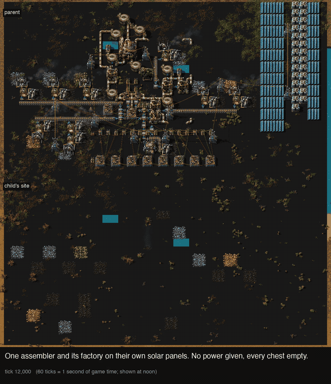
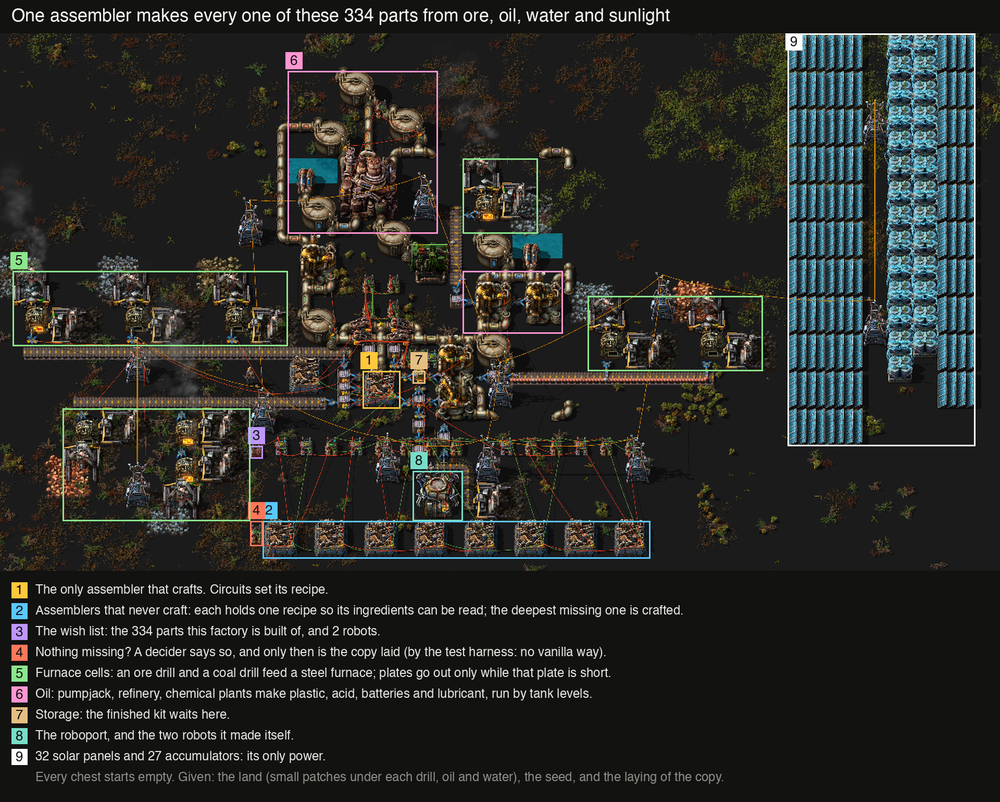
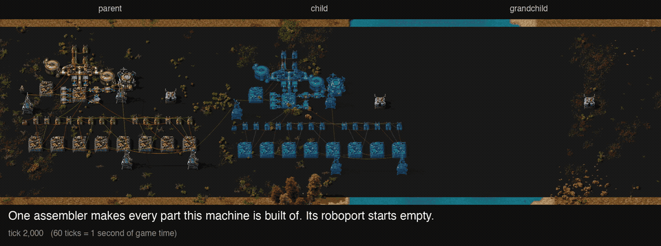
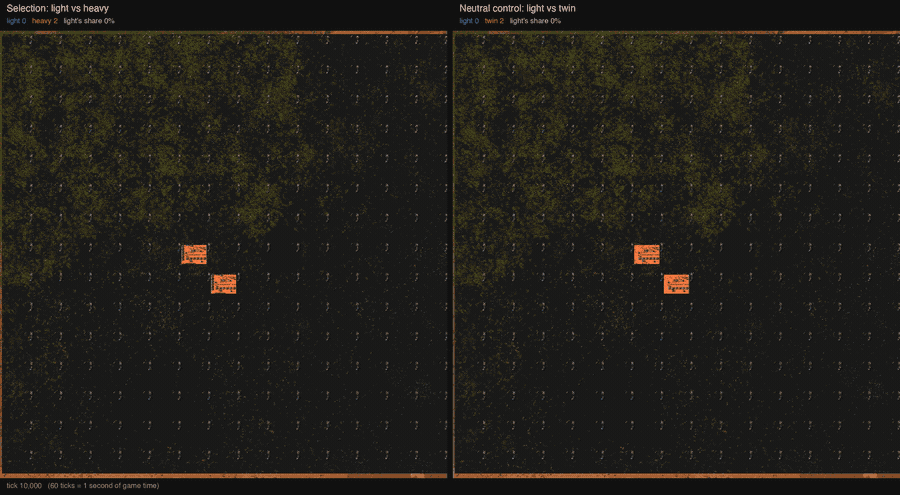

# factorio-evolution



*The upper factory, on its own solar panels, makes all 334 of its parts;
when the kit is complete the ghost of a copy is laid below, its two
robots build it, the parent is deleted, and the copy makes robots of
its own. Filmed in the game's window; the graded run is headless
([details](#from-land-and-sun)).*

**factorio-evolution holds self-copying machines built only from
base-game Factorio 2.1 parts, run headless and measured: a single
assembler that makes all 334 parts of its own factory (drills, furnaces,
oil refinery and solar field included) from ore, crude oil, water and
sunlight, whose copy then runs alone, and a colony in which a cheaper
lineage outgrows a costlier one by natural selection. In both, the only
scripted act is placing a machine's blueprint where it asks, which no
vanilla mechanism can do; the colony is supplied plates and power, and
the land-and-sun machine is given small prepared ore patches and no
enemies.**

*One assembler makes every part of its own factory from land and sun.
Vanilla Factorio can do everything a self-replicator needs, except place
a blueprint; we scripted only that, and in a colony of smaller
machines watched evolution happen.*

In numbers (each from graded runs; the game build stated):

- **From land and sun**: from empty chests and no power source, one
  assembler makes 334 parts and two robots; the copy is laid whole when
  the kit is complete (tick 542,520), built at 818,200, on its own solar
  grid, and makes its own robots after the parent is deleted, Factorio
  2.1.24.
- **Its own robots**: a 66-part machine makes its roboport and two
  construction robots; with the parent and every robot deleted, the
  child builds the grandchild alone (270,200 and 269,400 ticks a
  generation), Factorio 2.1.22.
- **Selection**: light's share of the grown colony is 0.587 where the
  other lineage pays a cost and 0.380 where it does not; every one of 10
  runs above every one of 10 (one-sided exact Mann-Whitney p = 5.4 ×
  10⁻⁶), Factorio 2.1.20.

[From land and sun](#from-land-and-sun) ·
[Its own robots](#the-step-before-it-makes-its-own-robots) ·
[Selection in a colony](#where-it-started-natural-selection-in-a-colony) ·
[The record](#the-labs-record) ·
[FAQ](#faq) · [Reproduce](#reproduce) · [Sources](#sources)

## Why this exists

Inspired by Anthropic's Claude-led discovery of a CRISPR-like enzyme
system ([September 2026][anthropic]). A personal project can't run a wet
lab, so this one uses Factorio as the lab: Claude pre-registers, runs and
grades each experiment headless; one person rules. Unlike that system,
these machines are built, not found, and their function is what gets
measured. Not affiliated with Anthropic.

## From land and sun

This machine is handed land: small ore patches under each drill, an oil spot under the
pumpjack, a pond under each offshore pump, no biters. One assembler
makes every one of the 334 parts its factory is built of, 18 electric
drills, 9 steel furnaces, a pumpjack, an oil refinery, 5 chemical plants,
32 solar panels and 27 accumulators among them, and two construction
robots, from the ore, crude oil and water its own drills and pumps take.
Every chest starts empty and its only power is its own panels.

When the whole kit stands in storage, a decider says so, and only then
is the copy's ghost laid (by the test harness: no vanilla mechanism lays
a blueprint), all 334 parts at once. The two robots build it. The copy
is on its own electric grid from its first panel (both grids read every
window: never the same one). Then the parent and every robot are removed,
and the copy makes two robots of its own.



| event | tick |
|---|---|
| the kit whole, the copy laid (334 ghosts at once) | 542,520 |
| the copy built | 818,200 |
| the parent and every robot removed | 1,100,000 |
| the copy's first robot / second robot | 1,104,800 / 1,112,400 |

One deterministic run of 1,600,000 ticks on Factorio 2.1.24; all five
registered predictions held. The film is the same machine filmed in the
game's window: that run is not byte for byte the graded one (the copy
laid 2,580 ticks earlier; the cause is not known), so its captions give
its own ticks. Laying the copy at the start instead, the same machine
took 989,000 ticks: robots took each part as it was made and the chain
made it again (read from the counts, not traced). The nearest known work
is a vanilla Space Age base on Fulgora that makes all its machines from
scrap, placed by hand; self-placing copies exist only with mods (see
Sources).

The machine is [`blueprints/land-and-sun.txt`](blueprints/land-and-sun.txt);
the run's experiment file, output and analysis are in
[`followup/e177-whole-child/`](followup/e177-whole-child/).

## The step before: it makes its own robots



A smaller, earlier machine, handed plates and power but no robots and
no roboport. One assembler makes all 66 parts the machine is built of, its
roboport included, and two construction robots. Two inserters load the
robots into a roboport that starts empty, and the roboport's robot count
is wired in as stock, so a robot that has left the chests still counts
and a third is never made. The two robots build a copy on a ghost of the
machine. Then the parent and every robot are removed, and a second ghost
is laid beyond the reach the parent's roboport had: the child makes its
own two robots and builds the grandchild alone, and the grandchild runs.


| generation | first robot | second robot | first part placed | copy built |
|---|---|---|---|---|
| parent (ticks from its start) | 48,200 | 50,800 | 48,800 | 270,200 |
| child (ticks from its fill) | 48,200 | 93,200 | 49,200 | 269,400 |

Given, not made: the ghost (placed by the script, once a generation), an
electric energy interface for each machine, and raw plates, plastic,
batteries and lubricant in its chests. One deterministic run of 620,000
ticks, made twice with the same output byte for byte, the second time
with the child's and the grandchild's roboports read (both on Factorio
2.1.22; the film was made on 2.1.24 and wrote the same output again). The first run's
three predictions held; of the second's four, one failed: the child's
second robot came 45,000 ticks after its first, where the parent's came
2,600 after, and the child built the grandchild's first 34 parts with
one robot, in no more time. Why is not known. Each generation also
makes one storage tank and one pipe more than it is built of, not
explained either. A single assembler that crafts anything from a list is
not new (see Sources, the recursive assembler); a build closing the loop
through its own robots and roboport was not found.

The machine is [`blueprints/self-reproducing.txt`](blueprints/self-reproducing.txt);
both runs' experiment files, output and analyses are in
[`followup/`](followup/) (no one-command kit for these yet: the output
and the scripts that read it, not the harness).

## Where it started: natural selection in a colony

The first result, and the repo's name: many copies of a 60-part
machine, each supplied plates, power and robots, competing for time.



*Blue: the light lineage. Orange: heavy (left) or its cost-free twin
(right). Both colonies start from two orange founders beside the centre;
blue arises only by mutation. Founders placed west and south of the
centre: of the ten founder placements, the one whose two colonies lie
nearest their arms' medians (0.612 against 0.592, and 0.379 against
0.406). [Watch every run in the browser.](https://hjkornn-phys.github.io/factorio-evolution/)*

### How the colony works

- **The engine: a universal assembler.** One crafter makes whatever its
  target needs, deepest ingredient first, steered by a stack of
  assemblers that never craft: each only reads its recipe's ingredients,
  one per depth. Within 2 crafts of the minimum for any target to its
  depth (5 electronic circuits in 14 crafts, minimum 13).
- **A machine makes its own kit.** All 60 parts it is built from, from
  plates, by recursion (596 seconds of recipe time a kit). It gives the
  whole kit to the logistic network, and construction robots build its
  child from it.
- **The machine decides when and where.** It raises a request when its
  kit is whole, and names a direction; a free site one step away gets
  the seed. This placing is the one scripted act: no trigger in the
  game's prototype data creates a building or a ghost, so in vanilla
  only a player lays a blueprint.
- **A census stops it.** Each machine's radar adds one to a count every
  radar shares; at the quorum it stops making kits.
- **Heredity and mutation.** A child takes its parent's blueprint,
  except when the parent's clock stands at a multiple of 7 as it lays
  (about 1 in 7): then the other lineage's.
- **A cost selection can act on.** The heavy lineage carries 24 idle
  parts (84 against 60). Its kit takes 1.50 times as long, and so does
  its generation: 214,890 against 143,460 ticks.

The machines' blueprints are in [`blueprints/`](blueprints/): light,
heavy, the twin and greedy. Each needs its site's supplies (power, a
roboport with robots, plates in storage) to run.

### Results

Twenty colonies of 224 machines, each founded by two machines of the
orange lineage beside the centre, ten founder placements, the same ten in
both arms. The arms differ only in the orange lineage's cost: heavy
carries 24 idle parts (its kit and generation 1.50 times light's); the
twin carries none.

| arm | runs | light's share, mean | least | most | grid full at (median tick) | mutant births |
|---|---|---|---|---|---|---|
| selection: light vs heavy | 10 | 0.587 | 0.504 | 0.665 | 2,626,830 | 14.6% |
| neutral control: light vs twin | 10 | 0.380 | 0.237 | 0.496 | 2,263,950 | 13.8% |

Registered before the runs: light's share larger with selection (p under
0.05); the means inside 0.42–0.64 and 0.30–0.52; every control colony
full between 1.9 and 2.5 million ticks, the selection colonies later;
mutant births 8–25%. All four held. Without an edge, drift at the
growing front spreads the control from 0.237 to 0.496; with it, every
colony is pulled the same way. Every run, with each machine's parent and
birth tick: [the viewer](https://hjkornn-phys.github.io/factorio-evolution/).

What it does not show: plates and power are supplied at every site, so
the machines compete for time, not matter; one mutation rate (about 1 in
7); a colony stopped at 224 by its census. The robots build whichever
ghost waits, so a lineage could in principle take another's parts; it
did not here: every child was built within 5,460 ticks of its seed (a
generation is about 143,000), since a parent lays its seed only when its
own kit is whole.

**The environment picks the winner.** A second lineage, greedy, carries
a second requester for each kind of plate (68 parts; its kit 1.13 times
light's). The logistic network divides a short kind evenly among open
requests, so greedy takes two turns where light takes one. Where plates
are plenty, the cheaper kit leads: light 8, greedy 7 when the census
stops the colony at 15, each light generation 12.5% shorter. Where plates
trickle in at one every 70 ticks, greedy leads, 8 to 5. Same machines,
opposite winners.

| supply | light | greedy | greedy's generation over light's |
|---|---|---|---|
| plenty (a pool of 40 kits) | 8 | 7 | 1.14 |
| trickle (one plate each 70 ticks) | 5 | 8 | 1.26 |

Both runs of each supply, founders swapped, gave the same counts. All
four registered predictions held, on runs repeated after a build fault
the first runs exposed (a second requester that never stopped filling
the first), fixed before the re-run with the prediction unchanged.

## The lab's record

Every experiment's prediction is committed before its first run, then
graded against it. Of 688 graded predictions across the lab's 174
graded experiments (2026-09-25 to 11-16), 555 held, 116 failed and 17
held in part; 77 experiments had at least one prediction fail. Failures
stay in the record, which stays private; each prediction cited here is
identified by the SHA-256 of the file as committed, before its result
was, and its text is available on request:

| experiment | what it predicted | SHA-256 |
|---|---|---|
| e143 | selection against its control | `be815e77611c0b77ea83cd80c312d8512dafc9539b17ef7b1d6d48c6d4b49c6b` |
| e144 | the supply picks the winner | `885bebc302f3ab75d2e2e9bc7061e3d826341da85a24bc5d775f5a4cde789ea9` |
| e142 | the kit's size as a cost in generations | `4a3d35fcd9e9011c230d610877431db7fd42d5fefc8e34e13986c0369002600b` |
| e141 | the lineage as a gene that mutates | `4a2481b633087b9de9e2769939ac2e9e3f91ae1dc942a56bd47d7b594f8451bc` |
| e135 | where a ghost can come from with no player | `800e4536d35c0e97a157c84bed5fb98d915ee2cd5f9cfdc7d276dbc4cb5c729f` |
| e160 | a second generation, by the child alone | `ae9f23017b548745925a8ba37ce0e377ada2340da9f85cdf6cf4f967e497592d` |
| e161 | the child's own two robots, read | `c49374919360eb9289042e29a77465a857f67e3f9c8cbfbb9ebf2786e22c6267` |
| e177 | from land and sun, the copy laid whole | `9a4ba7204dfb32a5943c168ebb7093b4a7564e1903b032308e1556b0ce41780b` |

The count is [`record/scoreboard.txt`](record/scoreboard.txt).

## FAQ

<details>
<summary><b>Why Factorio?</b></summary>

A personal project can't run a wet lab. Factorio is
deterministic (the same save gives the same run, tick for tick), runs
headless at thousands of ticks a second, and its rules are fixed and
readable from its prototype data. Its circuit network, logistic robots
and assemblers are enough to build a machine that makes its own parts.

</details>

<details>
<summary><b>Is this vanilla?</b></summary>

The machines are base-game Factorio 2.1 entities
only. A small harness mod does three things: it builds the world, records
what happens, and places a machine's blueprint as ghosts at the site the
machine names when the machine asks. Robots then build the ghosts from
the parent's kit. Plates and power are supplied at every site.

</details>

<details>
<summary><b>Can Factorio self-replicate without mods?</b></summary>

Everything except placing
the blueprint. A scan of the game's prototypes found nothing that lays a
building or a ghost without a player; ghosts appear only where an entity
died (e135). So the one scripted act is the placing, and it happens only
when the machine's own circuit asks.

</details>

<details>
<summary><b>How does mutation work?</b></summary>

Each machine has a clock. When it asks for a
child, the child gets the parent's blueprint, unless the clock stands at
a multiple of 7 at that moment: then the child gets the other lineage's.
About 1 birth in 7 is a mutation, in either direction (14.6% and 13.8% of
births in the two arms).

</details>

<details>
<summary><b>How is this different from GreyGoo or Recursive Blueprints?</b></summary>

GreyGoo
Mk I (2017) grows one factory that places mining stations, hauls ore by
train and lays solar fields, using the Recursive Blueprints mod, whose
Blueprint Deployer builds a blueprint when the circuit network signals
it (supported up to Factorio 1.1). Here many copies of one machine each
make every part of their own child from plates, decide when and where the
child goes, and stop at a census; two lineages of them compete, and
selection is measured against a control.

</details>

<details>
<summary><b>Is anything here new?</b></summary>

Parts of it are known. Recursive assemblers
with one reader per recipe depth have been posted since 2024, and a
vanilla Space Age base that makes all its own machines was shown in 2026,
placed by hand. What we did not find before this: a colony of machines
that copy themselves, grown on a grid and stopped by its own census, with
heritable variation and selection measured against a control. Searched
again 2026-09-30 (the forum, Reddit, arXiv): self-replicating factories
are an old goal of the game's players (a 2016 forum thread calls them
"one of the Reasons, why Factorio exists"), with no lineages or
selection. Mutants spreading in sectors of an expanding colony are known
from simulations of self-replicating colloids (2016), and the colonies
here grow the same way.

</details>

<details>
<summary><b>Can a Factorio factory build a copy of itself from raw resources, without mods?</b></summary>

Everything but the placing: the land-and-sun machine
mines ore with its own electric drills, smelts it in its own steel
furnaces, pumps crude oil and water, refines oil into plastic, sulfuric
acid, batteries and lubricant, and makes every one of its 334 parts and
two robots in one assembler; its robots build the copy. The copy's ghost
is laid by the harness, once, when the machine's circuit says the kit is
complete (e177, Factorio 2.1.24).

</details>

<details>
<summary><b>What powers it?</b></summary>

Its own 32 solar panels and 27 accumulators, made by
it and part of the kit; no energy interface anywhere. The copy is on its
own electric grid from its first panel (the grids read every window,
never the same); its watched accumulator never fell under 1,635 kJ after
the parent was deleted (e177).

</details>

<details>
<summary><b>What is given, then?</b></summary>

The land, prepared: small ore patches laid under
each drill, an oil spot under the pumpjack, a pond under each offshore
pump, the same for the copy's site, and no biters. The first machine (the
seed). The placing of the copy's blueprint. Nothing in its chests.

</details>

<details>
<summary><b>How does it know the kit is complete?</b></summary>

A constant combinator holds the
kit (334 parts and 2 robots); the stock (every chest, the crafter, the
robots in the roboport) is subtracted; one decider outputs a signal while
nothing on that difference is positive. Laying the copy only then made a
generation faster than laying its ghost at the start (818,200 against
989,000 ticks): with the ghost standing, robots took each part as it was
made and the crafter made it again.

</details>

<details>
<summary><b>How does it differ from Self-Expanding Blueprints, Proliferation, the Fulgora base or TAFK?</b></summary>

Self-Expanding Blueprints (a 2.1 mod, 2026) places
copies of a player's blueprint "whole or not at all" once the network holds
their cost, from parts the player's factory makes. Proliferation (a mod)
adds a machine faction with its own entities. mmarss256's Fulgora starter
base (2026) is vanilla Space Age and makes all its machines from scrap,
placed by hand. TAFK, on the Factorio forum, is a self-unpacking factory kit that used a
mod for oil. Here one base-game assembler makes every part from ore, oil,
water and sunlight, and the harness lays only the copy's ghost.

</details>

## Reproduce

Each result ships as a kit in [`reproduce/`](reproduce/): the
experiment's variants (world, machines and blueprints, one JSON each),
its analysis, the expected table, each run's growth events, and the
harness cut to what it needs. On Factorio 2.1.20, base game:

```
cd reproduce/e143-selection
python3 reproduce.py --factorio /path/to/factorio --data /path/to/factorio/data
```

Twenty headless runs of 3,500,000 ticks, about 25 minutes each on an
Apple Silicon Mac; it grades them and exits 0 when the table matches the
graded one. A quick check of one run's first 200,000 ticks against the
graded run's growth events:

```
python3 reproduce.py --quick sel-ws 200000 --factorio /path/to/factorio --data /path/to/factorio/data
```

The defaults are Steam's paths on macOS. `reproduce/e144-greedy` works
the same way (four runs of 800,000 ticks).

## Sources

- [Anthropic: Claude discovers a novel enzyme system][anthropic]
- [Tierra, Thomas Ray's own account](https://talkorigins.org/faqs/tierra.html):
  evolution among self-replicating programs; parasites, immunity
- [Avida](https://alife.org/encyclopedia/digital-evolution/avida/)
- [Invasion genetics](https://en.wikipedia.org/wiki/Invasion_genetics):
  drift and surfing at an expanding front
- [Mutation at Expanding Front of Self-Replicating Colloidal Clusters](https://arxiv.org/abs/1607.05802)
  (Tanaka, Zeravcic and Brenner, 2016)
- [Self Replicating (e. g. with Blueprints)](https://forums.factorio.com/viewtopic.php?t=27054)
  (the Factorio forum, 2016)
- [GreyGoo Mk I: a self-expanding factory](https://forums.factorio.com/viewtopic.php?t=41377)
  (2017)
- [Recursive Blueprints](https://mods.factorio.com/mod/recursive-blueprints)
  (DaveMcW): the Blueprint Deployer
- [Automated blueprint laying for auto base expansion](https://forums.factorio.com/viewtopic.php?t=80018):
  "In vanilla, no. Blueprints can only be designated by the player"
- [Generic recursive assembler](https://forums.factorio.com/viewtopic.php?t=122653)
  (2024), [a recursive single-assembler mall](https://www.reddit.com/r/factorio/comments/1heuv78/)
  (2024): the reader-per-depth idea behind the engine
- [A mini self-replicating Fulgora starter base](https://www.reddit.com/r/factorio/comments/1q8kq0j/)
  (2026): a vanilla base that makes all its own machines, placed by hand
- [Self-Expanding Blueprints](https://mods.factorio.com/mod/self-expanding-blueprints)
  (2026, a 2.1 mod): copies placed "whole or not at all" once the network holds their cost
- [Proliferation](https://mods.factorio.com/mod/proliferation) (2026, a mod):
  a machine faction whose bases mine, grow and found new bases
- [TAFK (Tochs Automatic Factory Kit)](https://forums.factorio.com/viewtopic.php?p=249446):
  a self-unpacking factory kit; true replication deferred, oil by a mod

## Cite

See [`CITATION.cff`](CITATION.cff). MIT licence ([`LICENSE`](LICENSE)).

[anthropic]: https://www.anthropic.com/news/claude-discovers-novel-enzyme-system
